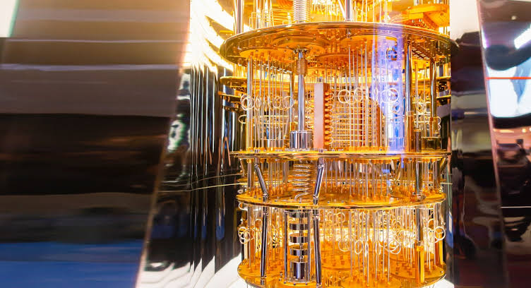

# Quantum Computing

## Presentation
[Click here to view the presentation.](https://docs.google.com/presentation/d/1cFL-JV3tSyiGHtFZxQRmIK9YwBV1DxgWAVKz2-I0N78/edit?usp=sharing)

## Code-Along
[Click here to open the Google Colab notebook.](https://colab.research.google.com/drive/15zdd0JoXWXyQ-BULKUEaP8yoQesQFZWg)

### Challenges
Here are some challenges to complete after following the notebook instructions:

- Get the highest possible value for the `11` measurement _without_ changing any code
- Change the code to get over **1000** results for the `00` measurement
- Change the code to get at least one result for the `10` measurement
- Change the code to get at least one result for the `101` measurement
- Change the code to show a different color on the output graph

## Resources
Here are some additional resources:

- [Cleveland Clinic Discovery Accelerator](https://my.clevelandclinic.org/research/computational-life-sciences/discovery-accelerator)
- [IBM Quantum Platform: Learning](https://quantum.cloud.ibm.com/learning/en)
- [Introduction to Classical and Quantum Computing (PDF)](./Assets/introduction-to-classical-and-quantum-computing-1e4p.pdf)
- [Quantum Computing for Everyone (PDF)](./Assets/QuantumComputingForEveryone.pdf)
- [Philosophy of QM lecture 1 slides (PDF)](./Assets/61cde33e772e736ccc9d896a58939728_lecture_1_2_2_05.pdf)
- [But what is quantum computing? (video)](https://www.youtube.com/watch?v=RQWpF2Gb-gU)
- [How Quantum Computers Break Encryption (video)](https://www.youtube.com/watch?v=lvTqbM5Dq4Q)
- [Quantum weirdness (Wikipedia)](https://en.wikipedia.org/wiki/Quantum_weirdness)
- [Quantum computing (Wikipedia)](https://en.wikipedia.org/wiki/Quantum_computing)
- [Grover's algorithm (Wikipedia)](https://en.wikipedia.org/wiki/Grover's_algorithm)
